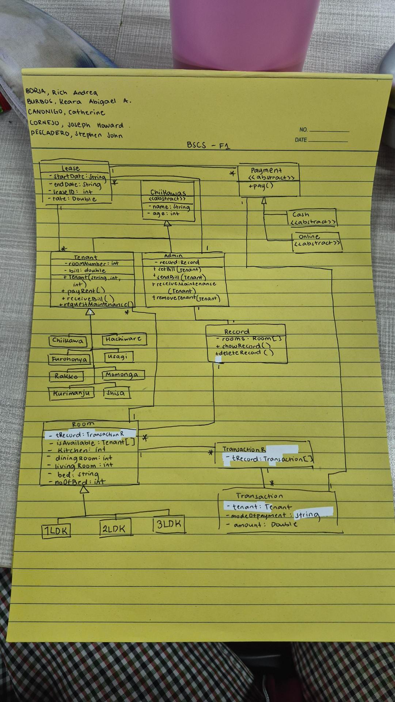

# chiikawa-dormitory 

--------------------------------------------------------------------------------- 
## Team Members
BORJA, Rich Andrea  
BURBOS, Keara Abigael  
CANONIGO, Catherine  
CORNEJO, Joseph Howard  
PESCADERO, Stephen John 

------------------------------------------------------------------------------

-------

## Details of Capstone

It is a Chiikawa dormitory game which uses the four principles of object-oriented programming. 
Inheritance, as the class "Chiikawas" allows the inheritance of its name. Polymorphism, Abstraction, and Encapsulation.

Players will work as a dormitory head, keeping track of available rooms, bills, maintenance, and their adorable tenants. 

A class named "Chiikawas" will contain the private name and age of the tenant, as well as be the base class for the Tenants.
There are currently eight tenants to meet: Chiikawa, Hachiware, Usagi, Momonga, Kurimanju, Shisa, Rakko, and Furuhonya.
They will come, ask for a place to stay (and they will stay that long!), and leave when it is over!

It is your job to manage, handle, and administer the dormitory!

-----

## Documentation 
### November 12, 2026

We made the initial codes for all of the classes, named:
- Chiikawas 
  - Tenant
    - Chiikawa
    - Hachiware
    - Usagi
    - Momonga
    - Furuhonya
    - Kurimanju
    - Shisa
    - Rakko
  - Admin
- Record
- Room
- Lease
- Payment
  - Cash
  - Online
- TransactionR (Transaction Record)
  - Transaction

We made the skeleton of the start screen which contains a play and exit button, 
alongside the title above it.

### November 15, 2026
- The start sreen and the three buttons (play, exit, credits) were made and added.  
- Added Chiikawa sprite.

### November 18, 2026
- The game screen with the baseScreen and spriteEnter wireframe were made and added
- added necessary elements

### November 19, 2026
- added option pane 
- added connection between start screen and game screen
- edited Room class
- edited functions in the game screen

 
